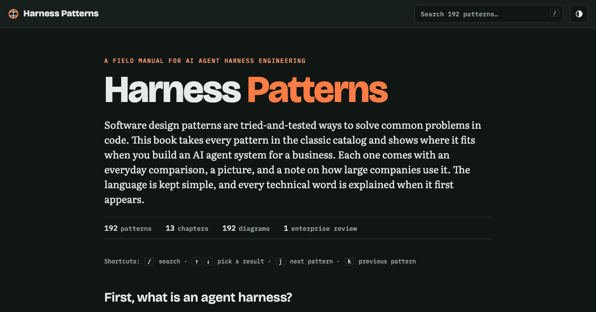

# Harness Patterns

A plain-English field manual of design patterns for building AI agent harnesses — the agent loop, the tool system, memory and more. Each pattern has a step-by-step explanation, a figure, a code sketch and a note on how large companies use it.

**Live site:** https://raghu298.github.io/agent-harness-engineering-pattern/

### Find things fast
- **Full-text search** across all 192 patterns: ranked results with the chapter and a highlighted snippet; finds word forms ("idempotency" → "idempotent")
- Shareable search links: `?q=retry` opens the results, `?q=circuit breaker` jumps straight to that pattern
- Wrong or old links (for example `/saga`) turn into a search instead of a dead 404 page
- Sidebar list filters by the full text too

### Read comfortably
- Light / dark / auto theme button (remembers your choice)
- **Continue reading** link on the cover that takes you back to the last pattern you read
- Previous / next links at the end of every pattern
- Reading progress bar and back-to-top button
- Long jumps are instant; the browser Back button moves between patterns
- Opening a link to a pattern lands exactly on it, even while fonts are loading

### Use and share
- **Copy** button on every code sketch
- `#` link next to each title copies a direct link to that pattern
- Install it as an app on a phone or desktop, and read it **offline**
- Link previews (image, title, description) on LinkedIn, WhatsApp, Slack and X
- Print layout that hides the menu and buttons

### Under the hood
- Fonts load without blocking the first paint
- Accessible search box (screen-reader combobox), labelled links and buttons
- Lighthouse: Accessibility 100 · Best Practices 100 · SEO 100

## Keyboard shortcuts

| Key | Action |
|---|---|
| `/` | Search |
| `↑` `↓` then `Enter` | Pick and open a search result |
| `Esc` | Close search |
| `j` / `k` | Next / previous pattern |

On a phone, tap **Contents** to open the pattern list.

## Files

| File | What it is |
|---|---|
| `index.html` | The whole book: text, diagrams, styles and scripts in one page |
| `404.html` | Turns a wrong address into a search |
| `sw.js`, `manifest.webmanifest`, `icons/` | Offline reading and "install as app" |
| `og.png` | Link preview image |
| `sitemap.xml` | For search engines |

## Run locally

Open `index.html` in a browser. Offline mode and install only work on the live HTTPS site.

## Deploy

GitHub Pages serves the `main` branch root. Every push to `main` goes live in about a minute.
